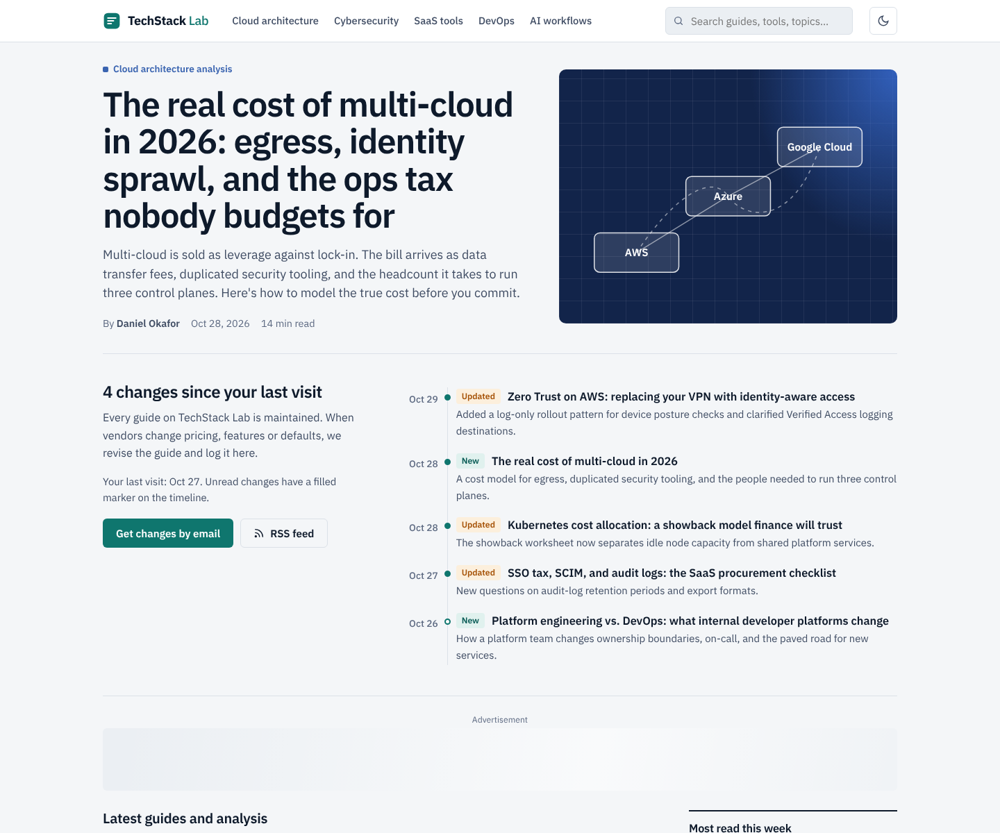
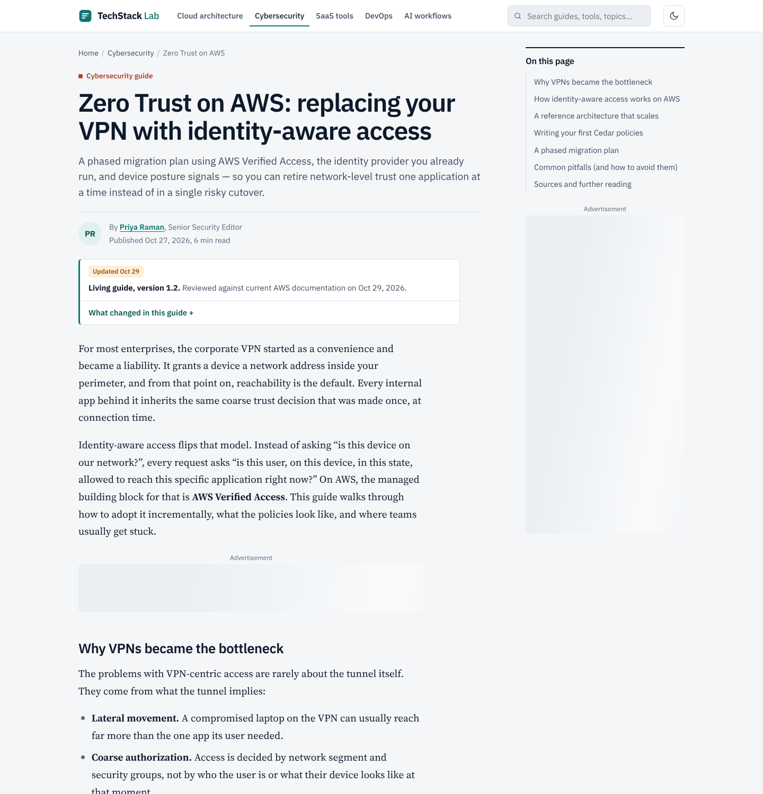
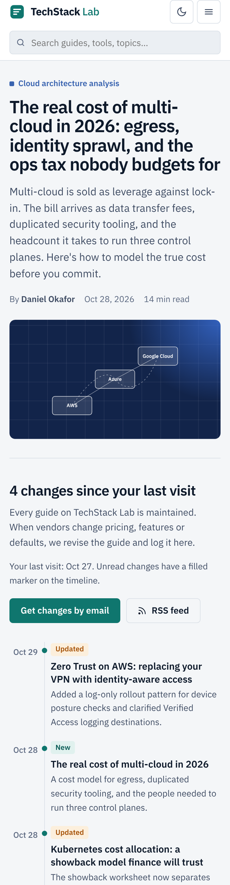
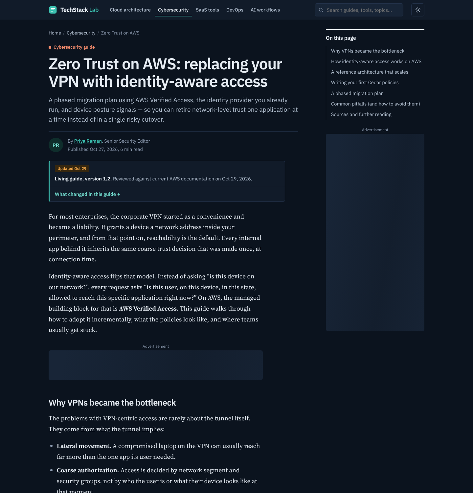

# TechStack Lab

Field-tested guides on enterprise cloud architecture, cybersecurity, DevOps, B2B SaaS and AI workflows — built as a fast, static, AdSense-ready publication at **techstacklab.site**.



| Article page | Mobile | Dark mode |
|---|---|---|
|  |  |  |

**What makes readers come back:** every guide is maintained like infrastructure. The homepage shows *what changed since your last visit*, each article carries a living-guide version and changelog, cards are badged **New** / **Updated**, and changes go out via The Weekly Stack email and an RSS feed.

**Stack:** plain HTML5, one CSS file, two small vanilla-JS files, self-hosted IBM Plex Sans and Source Serif 4. No build step, no framework, no third-party requests until a visitor consents to ads.

## Repository layout

```
public/                  ← the website (this folder is what gets deployed)
  index.html             homepage: hero, changelog, article grid, sidebar, newsletter band
  article-template.html  single guide: living-guide status, TOC, ad slots, author box, related
  about.html  contact.html  privacy.html  terms.html  404.html
  styles.css             design system: tokens, light/dark, CLS-safe ad reservations
  site.js                theme, nav, search, filters, TOC, last-visit changelog, forms, consent UI
  adsense-config.js      Consent Mode v2, lazy AdSense loader, fail-closed ID checks
  ads.txt  robots.txt  sitemap.xml  feed.xml
  fonts/                 self-hosted WOFF2 + OFL licences
scripts/preflight.sh     deploy gate: blocks production builds while placeholders remain
docs/screenshots/        images used in this README
STRATEGY.md              niche, content silos, ad-placement plan
AUDIT.md                 pre-production audit and fixes
netlify.toml  vercel.json  hosting config (publish directory: public/)
```

Documentation and scripts live outside `public/`, so they are never served on the live site.

## Before you go live — required edits

1. **Publisher ID** — replace `ca-pub-XXXXXXXXXXXXXXXX` in every `public/*.html` `<meta name="google-adsense-account">`, in `adsense-config.js` (`CONFIG.client`), and `pub-XXXXXXXXXXXXXXXX` in `ads.txt`.
2. **Ad unit IDs** — after approval, create six display units in AdSense (Ads → By ad unit) and paste their IDs into `CONFIG.slots`.
3. **Authors** — the bylines (Daniel Okafor, Priya Raman, Marcus Lindqvist, Aisha Benali) are sample names. Replace them with real contributors and real profile links (search for `REPLACE`). Do not publish invented people or credentials.
4. **Legal fields** — add your legal entity, business address (`contact.html`, `privacy.html`) and governing-law jurisdiction (`terms.html`). Have the Privacy Policy and Terms reviewed by a lawyer; they are solid templates, not legal advice.
5. **Images** — add `/assets/logo-600x60.png`, `/assets/og-default.png` and article cover images referenced in meta tags and JSON-LD.
6. **Consent in the EEA/UK/Switzerland** — Google requires a Google-certified CMP to serve ads to these visitors. Easiest path: AdSense → Privacy & messaging → create a GDPR message (and a US states message), then set `useGoogleCMP: true` in `adsense-config.js`. The custom banner then stays hidden and the footer "Cookie settings" link reopens Google's message. Keep `false` only if you use another certified CMP wired to the same API.

## Creating new articles

1. Copy `public/article-template.html` into a silo folder, e.g. `public/devops/terraform-state-at-scale/index.html`.
2. Update `<title>`, description, canonical, OG tags, all JSON-LD fields, breadcrumb, headline, byline, dates and body.
3. Each `<h2 id="...">` becomes a TOC entry automatically; read time is computed automatically.
4. Delete the **Mid-Content #2** slot on posts under ~1,800 words.
5. Add the article to the `ARTICLES` array in `site.js` (search index), to `index.html` (card + changelog entry), `sitemap.xml` and `feed.xml`.
6. On every substantive revision: bump the living-guide version, add a line to its changelog, add a changelog entry on the homepage, set `data-updated` on its card, and add a `feed.xml` item.
7. All internal links use root paths (`/styles.css`, `/about.html`), so pages work at any folder depth.

> Once you pass ~30 articles, consider moving to a static site generator (Eleventy, Astro or Hugo) using these files as the layout — it removes the manual copy step and generates category pages, sitemap and search index for you.

## Preflight check

Run `sh scripts/preflight.sh` before every production deploy. It fails if any publisher ID, author profile, address or jurisdiction placeholder is still present, or if a page is missing its Privacy Policy link. Netlify and Vercel run it automatically as the build step.

## Local preview

Root-relative paths need a web server (opening the file directly won't load CSS):

```bash
npx serve public          # or: cd public && python3 -m http.server 8080
```

## Deploy

### Option A — Netlify (recommended: contact form works with zero setup)
1. Push this repository to GitHub.
2. Netlify → **Add new site → Import an existing project** → pick the repo. Build settings are read from `netlify.toml` (build command runs `scripts/preflight.sh`, publish directory `public`). For a preview before your IDs are ready, add the environment variable `ALLOW_PLACEHOLDERS=1`; remove it for production.
3. **Domain management → Add domain** → `techstacklab.site`, then point DNS at Netlify (or move nameservers). HTTPS is issued automatically.
4. **Forms** → enable form detection; submissions from `contact.html` appear there. Add an email notification to support@techstacklab.com.

### Option B — Vercel
1. Push to GitHub → Vercel **Add New → Project** → import. Framework preset: **Other**; build command and output directory come from `vercel.json`. Use `ALLOW_PLACEHOLDERS=1` for previews only.
2. **Settings → Domains** → add `techstacklab.site` and follow the DNS instructions.
3. Contact form: create a free Formspree form and set the `action` attribute of the contact and newsletter forms in `public/contact.html` and `public/index.html` to `https://formspree.io/f/YOUR_ID`.

### Option C — WordPress
These files are a design reference, not a WP theme. Practical path: use a lightweight block theme (e.g. GeneratePress or Kadence), paste `styles.css` into **Appearance → Customize → Additional CSS** (or a child theme), recreate About/Contact/Privacy/Terms as Pages with the text provided, use **Site Kit by Google** to connect AdSense, and Rank Math or Yoast for schema and sitemaps. Insert ad units with a block-based ad inserter and keep the same placements and reserved heights.

### After deploy
- Google Search Console → add the domain property → submit `https://techstacklab.site/sitemap.xml`.
- Run PageSpeed Insights on the homepage and an article (mobile). Targets: LCP < 2.5s, CLS < 0.1, INP < 200ms.
- Check `https://techstacklab.site/ads.txt` loads as plain text.

## Apply to Google AdSense

1. **Get the content in place first** — 25–35 original, substantive articles across all five categories; every nav link leads to real content (see the checklist in `STRATEGY.md`).
2. Go to **adsense.google.com → Get started**, sign in, enter `techstacklab.site`, choose your country and accept the terms.
3. **Connect your site** — choose the meta tag method (already in every page's `<head>`, just swap in your real ID) or the AdSense code snippet. Click **Verify**.
4. Make sure `ads.txt` contains your real publisher ID.
5. Set up **Privacy & messaging** (GDPR + US states messages) as described above.
6. Click **Request review**. Reviews commonly take from a few days to several weeks. Don't make large structural changes or remove the verification tag while under review.
7. **If rejected**, read the reason (most often "Low value content" or "Site navigation"), fix it — usually by adding depth and originality to articles — and re-apply after a couple of weeks.
8. **After approval** — create the six ad units, paste the IDs into `adsense-config.js`, deploy, then check reports for viewability and RPM per placement after 2–4 weeks before changing anything.

### Policy guardrails built into this package
- No ad refresh (prohibited for AdSense publishers).
- Every ad is labeled "Advertisement" and kept away from nav and buttons (accidental-click policy).
- Ads are not placed on About, Contact, Privacy or Terms.
- Never click your own ads or ask others to; use AdSense's preview tool to check placements.

## Design files

The Figma file **TechStack Lab — Website Redesign** holds the colour tokens (Light and Dark), spacing and radius tokens, 19 text styles and a starter component sheet. The badge and category-tag variant sets need two small fixes (resize to fit contents, per-variant labels). Screens were not built in Figma because the Starter plan's monthly MCP call limit was reached; the HTML in `public/` is the source of truth.
